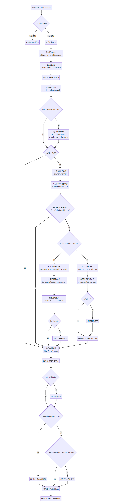
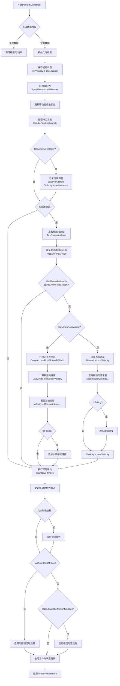

CharacterMovementComponent(简称CMC)是Unreal Engine中角色移动的核心组件，它负责处理角色的各种运动状态和移动的物理交互。

本文将主要解析`UCharacterMovementComponent::PerformMovement()`函数，主要关注于各种运动来源间的协作方式。

<!-- more -->

# 一、CMC运动的基本组成

角色的最终运动是由多个来源共同作用的结果：

1. **玩家输入** - 通过控制器常规接口提供的方向和速度
2. **物理交互** - 重力、摩擦力、碰撞等物理作用
3. **根运动动画** - 由动画资产提供的预定义运动
4. **根运动源** - 程序化生成的各类运动力
5. **移动模式特定逻辑** - 行走、飞行、游泳等不同模式的处理逻辑

# 二、PerformMovement详细流程图







# 三、运动计算流程详解

## 初始化与状态保存

```cpp
void UCharacterMovementComponent::PerformMovement(float DeltaSeconds)
{
    // 有效性检查
    if (!HasValidData() || DeltaSeconds <= 0.f)
    {
        return;
    }

    // 保存初始状态
    FVector OldVelocity = Velocity;
    FVector OldLocation = UpdatedComponent->GetComponentLocation();

    // Scoped updates can improve performance of multiple MoveComponent calls.
    {
        FScopedCapsuleMovementUpdate ScopedMovementUpdate(UpdatedComponent, bEnableScopedMovementUpdates);

        // ... 后续逻辑 ...
    }
}
```

这个阶段有几个关键点：

- **状态保存**：记录移动前的速度和位置，为后续计算和可能的回滚做准备
- **性能优化**：使用`FScopedCapsuleMovementUpdate`创建作用域更新，优化多次移动组件调用

## 基础移动更新与根运动源清理

```cpp
// 处理基于物体的移动(如站在移动平台上)
MaybeUpdateBasedMovement(DeltaSeconds);

// 清理无效根运动源
const bool bHasRootMotionSources = HasRootMotionSources();
if (bHasRootMotionSources && !CharacterOwner->bClientUpdating && !CharacterOwner->bServerMoveIgnoreRootMotion)
{
    const FVector VelocityBeforeCleanup = Velocity;
    CurrentRootMotion.CleanUpInvalidRootMotion(DeltaSeconds, *CharacterOwner, *this);

    // 调试代码省略...
}
```

这段代码符合了两个重要机制：

1. **基础移动处理**：

   - 当角色站在移动物体上时，需要继承该物体的运动
   - `MaybeUpdateBasedMovement`确保角色跟随其基础物体运动

2. **根运动源生命周期管理**：

   - 系统会清理无效或自然结束的根运动源
   - 这些源在结束时可能会修改速度(通过限制或覆写)
   - 清理操作的时机精心设计，在应用累积力和处理待定发射之前，以确保根运动源的结束行为不会被覆盖

## 应用累积力和更新移动前状态

```cpp
// 应用累积的力
ApplyAccumulatedForces(DeltaSeconds);

// 更新角色状态
UpdateCharacterStateBeforeMovement(DeltaSeconds);

// 处理待定的发射(如跳跃等突发力)
HandlePendingLaunch();
```

这个阶段处理各种力的影响：

- **累积力**：来自推力、冲击等外部施加的力
- **角色状态更新**：更新基于当前状态的角色属性
- **待定发射**：处理如跳跃等需要立即应用的突发力

## 跟踪外部速度变化

```cpp
// Update saved LastPreAdditiveVelocity with any external changes to character Velocity that happened since last update.
if (CurrentRootMotion.HasAdditiveVelocity())
{
    const FVector Adjustment = (Velocity - LastUpdateVelocity);
    CurrentRootMotion.LastPreAdditiveVelocity += Adjustment;

    // 调试代码省略...
}
```

这段代码处理的是一个高级特性：**外部速度变化适应**。它解决了一个重要问题：

- **问题**：当其他系统(如物理碰撞)修改了角色速度，添加型根运动源需要知道这些变化
- **解决方案**：计算上次更新后发生的外部速度调整，并相应更新基准速度
- **目的**：确保添加型根运动源能够在复杂情况下(如碰撞后)正确应用，避免不合理的行为(如穿墙)

## 准备和应用根运动

```cpp
// 准备动画根运动
if (CharacterOwner->IsPlayingRootMotion() && CharacterOwner->GetMesh() && 
    CharacterOwner->GetMesh()->IsComponentTickEnabled())
{
    TickCharacterPose(DeltaSeconds);
    // 提取根运动数据...
}

// 准备非动画根运动源
if ((bHasRootMotionSources || CharacterOwner->IsPlayingRootMotion()) && 
    !CharacterOwner->bServerMoveIgnoreRootMotion)
{
    CurrentRootMotion.PrepareRootMotion(DeltaSeconds, *CharacterOwner, *this, true);
}

// 应用根运动到速度
if (CurrentRootMotion.HasOverrideVelocity() || HasAnimRootMotion())
{
    // 动画根运动处理
    if (HasAnimRootMotion())
    {
        // 复杂的动画根运动处理逻辑...
    }
    // 非动画根运动处理
    else
    {
        FVector VelocityOverride = Velocity;
        CurrentRootMotion.AccumulateOverrideRootMotionVelocity(DeltaSeconds, *CharacterOwner, *this, VelocityOverride);
        Velocity = VelocityOverride;
    }
}
```

这个阶段展示了根运动处理的核心逻辑：

1. **准备阶段**：

   - 对于动画根运动，需要先更新骨骼姿势(`TickCharacterPose`)
   - 对于根运动源，调用`PrepareRootMotion`准备根运动数据

2. **应用逻辑**：

   - 优先级：动画根运动 > 非动画根运动源
   - 动画根运动有特殊处理，包括世界空间转换和限制
   - 非动画根运动源使用累积机制，根据优先级和累积模式应用

3. **速度覆写机制**：

   - 覆盖型根运动直接覆写速度
   - 叠加型根运动在原有速度基础上添加影响
   - 特殊处理坠落状态时的速度合成

## 执行移动状态的物理逻辑

```cpp
// 执行实际的物理移动
StartNewPhysics(DeltaSeconds, 0);

// 更新移动后状态
UpdateCharacterStateAfterMovement(DeltaSeconds);
```

这是物理模拟的核心，根据当前移动模式执行相应计算：

```cpp
void UCharacterMovementComponent::StartNewPhysics(float DeltaTime, int32 Iterations)
{
    switch (MovementMode)
    {
        case MOVE_Walking:
            PhysWalking(DeltaTime, Iterations);
            break;
        case MOVE_Falling:
            PhysFalling(DeltaTime, Iterations);
            break;
        // 其他移动模式...
    }
}
```

每种移动模式都有专门的物理处理逻辑：

- **行走模式**：处理地面行走、斜坡、台阶等
- **坠落模式**：应用重力、空气阻力和空中控制
- **游泳模式**：计算浮力和水中运动
- **飞行模式**：处理自由空间中的运动

在每种移动模式下，都会做出特别的处理应实现符合人类直觉的移动方式。这里暂且不展开讨论

## 应用旋转和收尾工作

```cpp
// 应用物理旋转
if (bAllowPhysicsRotationDuringAnimRootMotion || !HasAnimRootMotion())
{
    PhysicsRotation(DeltaSeconds);
}

// 应用动画根运动的旋转
if (HasAnimRootMotion())
{
    // 应用动画根运动旋转...
}
// 应用根运动源的旋转
else if (CurrentRootMotion.HasActiveRootMotionSources())
{
    FQuat RootMotionRotation;
    if (CurrentRootMotion.GetOverrideRootMotionRotation(DeltaSeconds, *CharacterOwner, *this, RootMotionRotation))
    {
        // 应用根运动源旋转...
    }
}

// 收尾工作
OnMovementUpdated(DeltaSeconds, OldLocation, OldVelocity);
```

最后阶段完成角色旋转和系统清理：

- **旋转处理**：根据当前状态应用相应的旋转源
- **优先级**：动画根运动旋转 > 根运动源旋转 > 物理旋转
- **移动完成通知**：触发回调，通知其他系统移动已完成

# 四、根运动源系统

根运动源系统允许程序化地控制角色移动，是动画根运动的补充。

## 根运动源类型

CMC支持多种类型的根运动源：

- **ConstantForce**: 施加恒定力
- **RadialForce**: 从一点向外或向内施加力
- **MoveToForce**: 将角色移动到指定位置
- **MoveToDynamicForce**: 将角色移动到动态变化的位置
- **JumpForce**: 模拟跳跃行为的力

## 添加根运动源

```cpp
uint16 FRootMotionSourceGroup::ApplyRootMotionSource(TSharedPtr<FRootMotionSource> SourcePtr)
{
    // 分配唯一ID
    uint16 NewID = GetNextLocalID();
    SourcePtr->LocalID = NewID;

    // 添加到待处理列表
    PendingAddRootMotionSources.Add(SourcePtr);

    return NewID;
}
```

## 根运动源参数

每个根运动源都可以配置多个参数：

- **优先级**: 决定源之间的优先顺序
- **累积模式**: 覆盖或叠加
- **持续时间**: 根运动应用的时长
- **强度**: 力的强度或运动速度
- **结束速度设置**: 根运动结束时的速度处理方式

## 根运动优先级排序

CMC严格遵循特定的优先级规则处理多个运动来源：

1. **动画根运动**: 最高优先级
2. **高优先级覆盖型根运动源**
3. **低优先级覆盖型根运动源**
4. **叠加型根运动源**: 按优先级顺序叠加
5. **常规移动计算**: 最低优先级

# 结语

CharacterMovementComponent的PerformMovement流程展示了Unreal Engine如何处理复杂的角色移动逻辑，特别是根运动的应用。

通过理解这一流程，可以更好地利用和拓展CMC的功能，实现统一且自然的角色移动效果。
